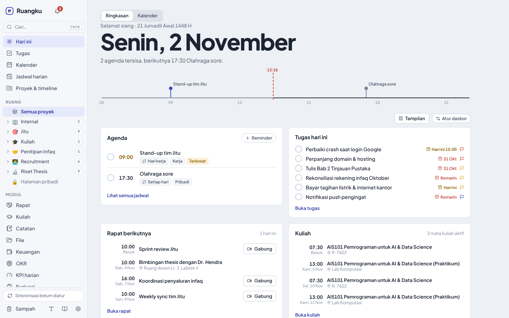
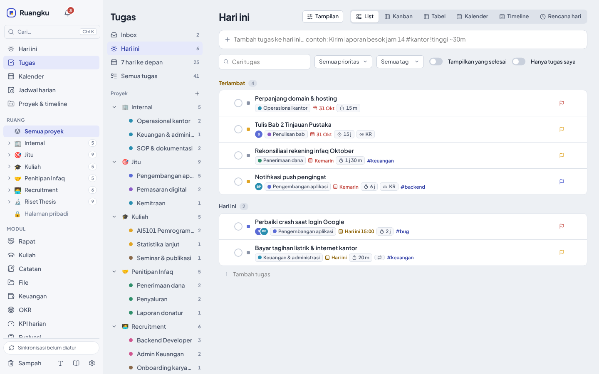
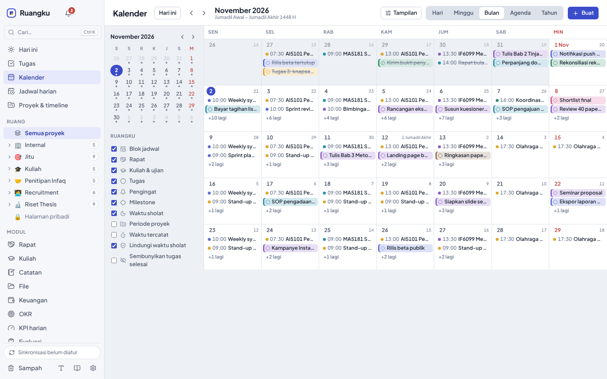
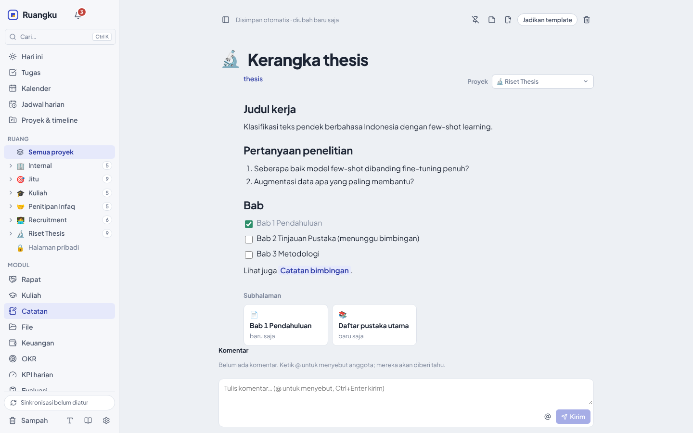
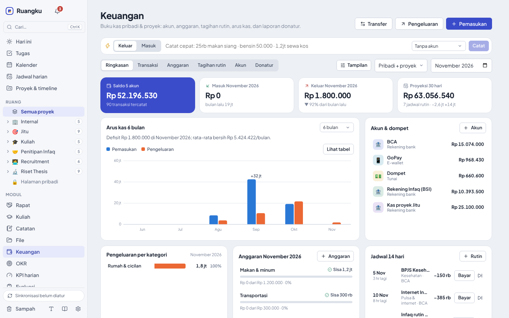
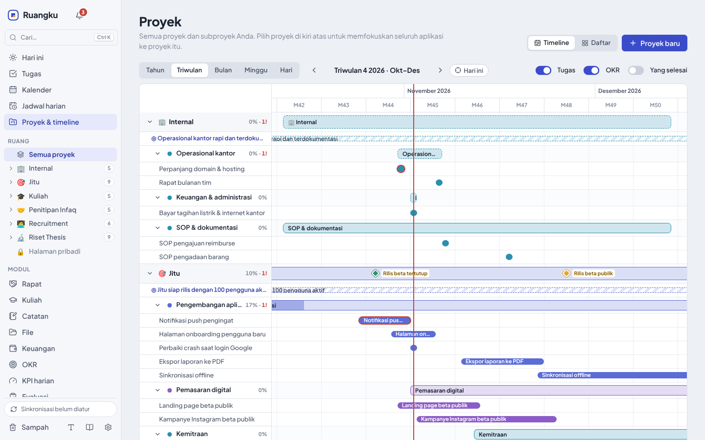
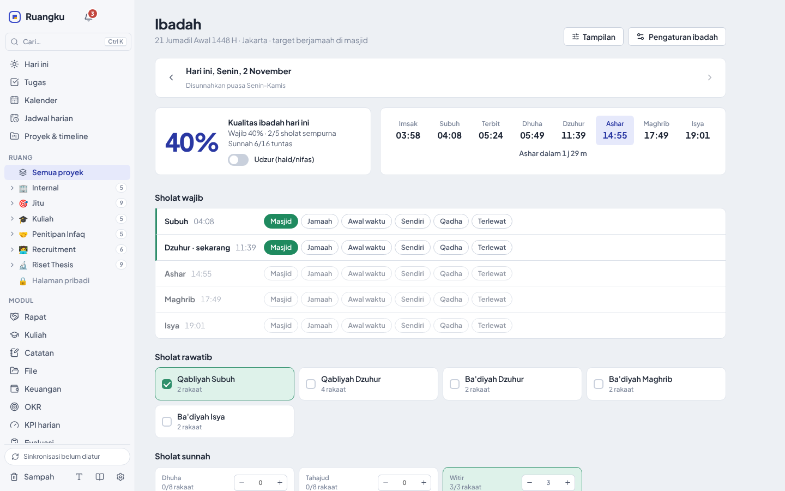

<div align="center">


# Ruangku

**Satu ruang kerja di desktop Windows untuk tugas, jadwal, catatan, keuangan, dan ibadah.**
Data tersimpan di komputer Anda sendiri dan tetap bisa dipakai tanpa internet.

[](https://github.com/yahyaaliman/ruangku/actions/workflows/ci.yml)
[](https://github.com/yahyaaliman/ruangku/releases/latest)


[**Unduh**](https://github.com/yahyaaliman/ruangku/releases/latest) · [Panduan](docs/panduan.md) · [Referensi fitur](docs/referensi-fitur.md) · [Catatan perubahan](CHANGELOG.md)

<picture>
  <source media="(prefers-color-scheme: dark)" srcset="docs/images/hari-ini-gelap.png">
  
</picture>

</div>

## Daftar isi

- [Mengapa Ruangku](#mengapa-ruangku)
- [Fitur](#fitur)
- [Memasang](#memasang)
- [Data dan privasi](#data-dan-privasi)
- [Dokumentasi](#dokumentasi)
- [Pengembangan](#pengembangan)
- [Rilis](#rilis)
- [Keamanan](#keamanan)
- [Lisensi](#lisensi)

## Mengapa Ruangku

- **Semua di satu tempat.** Tugas, kalender, rapat, kuliah, catatan, keuangan, OKR, KPI, dan ibadah saling terhubung. Rapat otomatis menjadi blok di kalender, tugas bisa ditautkan ke key result, dan rencana hari menghindari waktu sholat.
- **Data milik Anda.** Semua data ada di database SQLite lokal dengan backup harian otomatis. Sinkronisasi antarkomputer dan kerja tim bersifat opsional.
- **Dibuat untuk Windows.** Widget di desktop, sticky note, catat cepat dari aplikasi mana pun (Ctrl+Shift+Space), notifikasi dengan tombol Selesai/Tunda, dan ikon tray yang menjaga pengingat tetap berjalan.
- **Nyaman dipandang.** Tema terang, gelap, atau mengikuti Windows, delapan warna aksen, dan ukuran tampilan, kepadatan, serta lebar halaman yang bisa diatur.
- **Berbahasa Indonesia sejak awal.** Teks cepat seperti `rapat klien besok jam 2 sore #kantor` dan `25rb makan siang` langsung dipahami. Libur nasional, cuti bersama, dan kalender Hijriah sudah tertanam.

## Fitur

| | |
| --- | --- |
|  |  |
| **Tugas & proyek**: List, Kanban, Tabel, Kalender, Timeline/Gantt, dan Rencana hari. | **Kalender**: Hari, Minggu, Bulan, Agenda, dan Tahun dari semua sumber waktu. |
|  |  |
| **Catatan**: editor blok ala Notion yang tetap menyimpan Markdown. | **Keuangan**: akun, anggaran, tagihan rutin, arus kas, dan dana titipan. |
|  |  |
| **Proyek & timeline**: subproyek, milestone, dan skala tahun hingga hari. | **Ibadah**: jadwal sholat offline, sunnah, puasa, skor, dan konsistensi. |

**Rencanakan pekerjaan**

- Proyek dan subproyek bersarang dengan status kustom, dependensi, tugas berulang, kolom kustom, timer, otomasi jika-maka, dan template proyek maupun hari.
- Kalender yang menyatukan blok jadwal, tugas, pengingat, milestone, waktu sholat, libur nasional, langganan ICS, Google Calendar, dan Outlook Calendar.
- Rapat dengan agenda, peserta, tautan Zoom/Meet/Teams, seri berulang, notulen, dan action item. Kuliah dengan jadwal semester, presensi, ujian, nilai, dan IPK.
- OKR per kuartal, KPI harian dengan streak, serta evaluasi harian, mingguan, dan bulanan yang terisi otomatis.

**Catat dan temukan**

- Catatan berbasis blok dengan perintah `/`, halaman bersarang, tautan `[[`, backlink, komentar dengan @sebutan, dan impor pustaka BibTeX (APA 7).
- Palet perintah Ctrl+K untuk mencari, membuat tugas dengan bahasa sehari-hari, dan menjalankan aksi.
- File manager dengan tag, favorit, pencarian, dan pratinjau gambar, PDF, dan teks.

**Jaga ritme**

- Jadwal sholat offline (kriteria Kemenag RI) untuk 48 kota, pengingat sholat dan puasa sunnah, mode udzur, dan mode Ramadan.
- Pengingat istirahat 50/10 dan istirahat mata 20-20-20 yang bisa diselaraskan dengan adzan.
- Widget desktop transparan berisi jam, ibadah, agenda, tugas, KPI, OKR, dan catatan.

**Bekerja bersama**

- Sinkronisasi antarkomputer lewat folder OneDrive/Google Drive/Dropbox atau akun Google, dengan penggabungan per kolom sehingga perubahan tidak saling menimpa.
- Server tim PocketBase dengan peran (pemilik, admin, editor, kontributor, pembaca) dan izin per proyek yang ditegakkan server.
- Bot WhatsApp, Telegram, dan Gmail untuk penugasan dan perintah singkat, plus rangkuman pagi.
- Asisten AI (Claude, ChatGPT, atau model kompatibel OpenAI seperti Ollama) dan server MCP untuk Claude Desktop, Claude Code, dan ChatGPT.

Rincian setiap modul ada di [Referensi fitur](docs/referensi-fitur.md).

## Memasang

**Kebutuhan:** Windows 10 atau 11 (64-bit). WebView2 sudah ada di Windows 10/11; bila belum, installer memasangnya.

1. Unduh **`Ruangku_<versi>_x64-setup.exe`** dari halaman [Releases](https://github.com/yahyaaliman/ruangku/releases/latest).
2. (Disarankan) cocokkan checksum dengan `SHA256SUMS.txt` di halaman rilis yang sama:

   ```powershell
   Get-FileHash .\Ruangku_1.0.0_x64-setup.exe -Algorithm SHA256
   ```

3. Jalankan installer. Ruangku dipasang untuk pengguna saat ini tanpa hak admin, lalu muncul di Start Menu.

Selama installer belum bertanda tangan kode, Windows SmartScreen menampilkan peringatan *Unknown publisher*. Setelah checksum cocok, pilih **More info → Run anyway**.

Saat pertama dibuka, Ruangku mengisi data demo (enam proyek contoh) dan menampilkan tur singkat. Hapus data demo kapan saja dari banner di atas halaman atau dari **Pengaturan → Umum**.

- **Memperbarui:** jalankan installer versi baru. Data tetap aman; bila Ruangku sedang berjalan, installer meminta izin untuk menutupnya. Bila komputer masih punya salinan lama yang dipasang lewat `.msi`, installer menawarkan untuk mencopotnya.
- **Mencopot:** **Pengaturan Windows → Aplikasi → Aplikasi terinstal → Ruangku**. Data tetap disimpan kecuali Anda mencentang *Hapus juga data aplikasi*.
- **Untuk admin IT:** tersedia `.msi` untuk pemasangan semua pengguna. Pilih salah satu jenis installer saja per komputer.

Rincian installer, verifikasi attestation, dan tanda tangan kode ada di [docs/instalasi-windows.md](docs/instalasi-windows.md).

## Data dan privasi

- Semua data tersimpan di `%APPDATA%\com.ruangku.app\ruangku.db` (SQLite). Backup otomatis harian ada di subfolder `backups` dan bisa dipulihkan dengan satu klik.
- Kunci API, token bot, dan login layanan disimpan di **Windows Credential Manager**, bukan di file pengaturan, dan tidak ikut sinkronisasi.
- Ruangku tidak mengirim data ke server mana pun kecuali layanan yang Anda hubungkan sendiri. Satu-satunya koneksi bawaan adalah pemeriksaan pembaruan harian ke GitHub Releases, yang bisa dimatikan di **Pengaturan → Data & keamanan**.
- Snapshot sinkronisasi bisa dienkripsi dengan kata sandi.

## Dokumentasi

| Dokumen | Isi |
| --- | --- |
| [Panduan pengguna](docs/panduan.md) | Cara memakai setiap halaman (juga ada di aplikasi: menu **Panduan**, F1). |
| [Referensi fitur](docs/referensi-fitur.md) | Rincian modul, notifikasi, widget, sinkronisasi, tim, bot, dan pintasan. |
| [Instalasi Windows](docs/instalasi-windows.md) | Jenis installer, verifikasi checksum dan attestation, tanda tangan kode. |
| [Integrasi dan keamanan](docs/integrasi-dan-keamanan.md) | Notifikasi, pembaruan di dalam aplikasi, Google Tasks, Outlook, izin proyek, enkripsi. |
| [Akun Google](docs/akun-google.md) | Mengaktifkan login dan sinkronisasi lewat Google Drive. |
| [Arsitektur](docs/arsitektur.md) | Struktur kode, model data, dan prinsip keandalan di Windows. |
| [Catatan perubahan](CHANGELOG.md) | Perubahan di setiap versi. |

## Pengembangan

Ruangku dibangun dengan [Tauri 2](https://v2.tauri.app): antarmuka React 19 + TypeScript di WebView2 dan backend Rust dengan SQLite.

**Kebutuhan:** [Node.js](https://nodejs.org) 22, [Rust](https://rustup.rs) stable, dan [Microsoft C++ Build Tools](https://visualstudio.microsoft.com/visual-cpp-build-tools/) (*Desktop development with C++*).

```powershell
npm ci                # pasang dependensi
npm run app:dev       # jalankan aplikasi dengan hot reload
npm test              # uji frontend (Vitest)
npm run test:rust     # uji backend (cargo test)
npm run app:build     # buat installer di src-tauri\target\release\bundle\
```

Tanpa Rust, `npm run dev` membuka pratinjau tampilan di http://localhost:1420 dengan data contoh dan backend tiruan (widget: http://localhost:1420/#widget).

```
src/            Antarmuka React + TypeScript (halaman, widget, editor catatan, AI, tim)
src-tauri/      Backend Rust: database, jendela, tray, notifikasi, sinkronisasi, server MCP, installer
server/         Skema dan hook PocketBase untuk kolaborasi tim
scripts/        Uji asap Windows dan pembuat manifest pembaruan
docs/           Dokumentasi dan gambar
```

Penjelasan lengkap ada di [docs/arsitektur.md](docs/arsitektur.md).

## Rilis

Dua workflow GitHub Actions mengurus pengujian dan rilis:

| Workflow | Kapan berjalan | Isi |
| --- | --- | --- |
| [**CI**](.github/workflows/ci.yml) | Setiap pull request dan push ke `main` (perubahan yang hanya menyentuh dokumentasi dilewati) | Dua job bersamaan: **Uji** (frontend, izin proyek di PocketBase, backend) dan **Installer & uji asap Windows** (build lalu pasang, buka semua halaman serta widget, sticky note, catat cepat, dan layar istirahat, tutup paksa, pasang ulang, copot). Installer bisa diunduh dari bagian *Artifacts* halaman run. |
| [**Rilis**](.github/workflows/release.yml) | Saat tag `v<versi>` dibuat | Memastikan tag sama dengan versi aplikasi, menguji, membuat dan menandatangani installer (bila sertifikat diatur), uji asap, pemindaian antivirus, checksum, attestation, lalu menerbitkan rilis dengan catatan dari CHANGELOG. Bisa dijalankan manual dari tab Actions sebagai uji coba tanpa menerbitkan. |

Langkah-langkah PowerShell keduanya ada di [`scripts/ci/`](scripts/ci), dan persiapan Node/Rust bersama ada di [`.github/actions/setup`](.github/actions/setup/action.yml). Dependabot mengusulkan pembaruan versi Action sebulan sekali.

Untuk rilis publik:

1. Samakan versi di `package.json`, `package-lock.json`, `src-tauri/tauri.conf.json`, `src-tauri/Cargo.toml`, dan `src-tauri/Cargo.lock` (uji otomatis menolak versi yang berbeda), lalu catat perubahannya di [CHANGELOG.md](CHANGELOG.md).
2. Push ke `main` dan tunggu **CI** hijau.
3. Buat tag `v<versi>`, misalnya lewat **Releases → Draft a new release** di GitHub atau `git tag v1.0.0 && git push origin v1.0.0`. Workflow **Rilis** menerbitkan installer, `.msi`, `SHA256SUMS.txt`, dan catatan rilis dalam sekitar 15 menit.

## Keamanan

Laporkan celah keamanan secara pribadi, bukan lewat issue publik. Lihat [SECURITY.md](SECURITY.md).

## Lisensi

Hak cipta © 2026 Ruangku. Repo ini belum memiliki lisensi open source, sehingga seluruh hak dilindungi. Hubungi pemilik repo sebelum menggunakan ulang kode.
